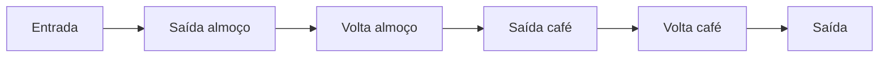

<div align="center">

# Registro de Ponto

**Sistema web de controle de jornada para a Prime Tecnologia**


[Funcionalidades](#funcionalidades) •
[Tecnologias](#tecnologias) •
[Como rodar](#como-rodar-localmente) •
[Rotas](#rotas-principais) •
[Estrutura](#estrutura-do-projeto)

</div>

---

## Sobre

O **Registro de Ponto** permite que funcionários registrem suas batidas do dia com um clique, enquanto gestores e administradores acompanham a equipe, lançam pontos manualmente, aprovam solicitações de ajuste e geram relatórios de banco de horas em tela ou em PDF.

---

## Funcionalidades

### Batida automática

O funcionário só clica em **Registrar Ponto**, e o sistema identifica sozinho qual é a próxima batida do dia:



- **Intervalo mínimo de 10 minutos** entre uma batida e outra, para evitar cliques repetidos.
- Aviso quando **todas as batidas do dia** já foram registradas.

### Painel do funcionário

- **Relógio de jornada**: um anel que vai se preenchendo conforme o tempo trabalhado no dia, descontando o almoço.
  - Muda de cor conforme o andamento: aguardando entrada, em andamento, jornada completa ou **hora extra**.
  - Passando a jornada (com a tolerância de 10 minutos), um segundo anel mostra o tempo de **hora extra**.
  - Ao passar o mouse, mostra o tempo trabalhado, quanto falta e a hora extra.
- **Batidas de hoje** em lista, com a opção de solicitar a exclusão de cada uma.
- **Batidas de ontem** em uma seção que abre e fecha.

### Interface

- Visual próprio com a identidade da **Prime Tecnologia** (logo e CSS personalizados).
- Telas de **login**, **cadastro** e **redefinição de senha** redesenhadas.
- **Menu no topo** que se adapta ao papel do usuário: gestores e administradores veem também Equipe, Solicitações Pendentes e Histórico de Alterações.
- Nome e função do usuário no topo, com botão de sair.

### Papéis de usuário

| Papel | O que pode fazer |
|---|---|
| **Funcionário** | Bater ponto, consultar as próprias batidas do dia, solicitar ajustes e gerar o próprio relatório de horas |
| **Gestor** | Tudo do funcionário + ver a própria equipe, lançar e excluir pontos, aprovar ou rejeitar solicitações, consultar o histórico e gerar relatórios da equipe |
| **Administrador** | Tudo do gestor + ver todos os funcionários cadastrados |

### Gestão de registros

- **Solicitações de ajuste pelo funcionário**, que ficam com status **Pendente** até serem revisadas:
  - **Inclusão**: para uma batida esquecida, informando tipo, data/hora e motivo.
  - **Exclusão**: para uma batida registrada por engano, direto do painel e com o motivo. O funcionário só pode pedir a exclusão das próprias batidas.
- **Aprovação de solicitações**: gestores e administradores veem as solicitações pendentes da sua equipe e decidem:
  - **Aprovar**: a batida é incluída ou excluída automaticamente, e a alteração fica registrada no histórico.
  - **Rejeitar**: o gestor informa o motivo da rejeição.
- **Lançamento manual**: gestores registram uma batida esquecida, informando o motivo.
- **Exclusão com histórico (soft delete)**: o registro não some do banco, só é marcado como inativo.
- **Histórico de alterações**: tela onde gestores e administradores consultam todas as inclusões e exclusões da equipe, com quem fez, quando e por quê.

### Relatório de banco de horas

- Escolha o **período** (data inicial e final) e o **funcionário**, ou marque **Gerar todos** para a equipe inteira.
- Para cada dia, o relatório mostra:
  - **Status**: *Completo* (tem entrada e saída) ou *Incompleto*, com atalho para solicitar o ajuste.
  - **Horas trabalhadas**: da entrada até a saída, descontando o intervalo de almoço.
  - **Jornada esperada**: 7h45min por dia.
  - **Saldo**: diferença entre o trabalhado e o esperado (positivo = hora extra, negativo = hora devida).
- **Tolerância de 10 minutos**: diferenças de até 10 minutos, para mais ou para menos, não entram no saldo do dia.
- O funcionário gera apenas o próprio relatório; gestores e administradores geram o da equipe.
- **Totais do período**: horas normais e horas extras de cada funcionário. As horas normais de cada dia ficam limitadas à jornada de 7h45min, e o que passar disso conta como hora extra.

### Exportação em PDF

- Botão **Baixar PDF** na tela de relatório, usando o mesmo período e funcionário escolhidos.
- Gera a **Folha de Ponto Individual de Trabalho** do mês, com nome e função do funcionário.
- Mostra todas as batidas de cada dia (entrada, almoço, café e saída) e um **resumo geral** com horas normais e extras.
- Com **Gerar todos**, sai uma folha para cada funcionário da equipe no mesmo arquivo.

### Usuários e acesso

- **Cadastro de usuários**: a própria pessoa se cadastra pela tela de login, informando nome, usuário, e-mail, CPF, **função** e senha. O perfil é criado automaticamente como **Funcionário**.
- **Validações no cadastro**: senhas iguais, nome de usuário e CPF únicos, e CPF com 11 dígitos (pode ser digitado com ou sem pontos e traço).
- **Redefinição de senha por e-mail**: link "Esqueceu sua senha?" no login, que envia um e-mail com o link para criar uma nova senha.
- **Funções (cargos)**: cadastradas pelo painel administrativo e vinculadas ao perfil do funcionário. A função aparece na folha de ponto em PDF.
- **Painel administrativo** do Django para gerenciar usuários, perfis, funções e registros.

---

## Tecnologias

| Tecnologia | Uso |
|---|---|
| [Python 3.12+](https://www.python.org/) | Linguagem |
| [Django 6.1](https://www.djangoproject.com/) | Framework web |
| [PostgreSQL](https://www.postgresql.org/) | Banco de dados |
| [python-decouple](https://pypi.org/project/python-decouple/) | Variáveis de ambiente (`.env`) |
| [Pillow](https://pypi.org/project/pillow/) | Suporte a imagens |
| [xhtml2pdf](https://pypi.org/project/xhtml2pdf/) | Geração do relatório em PDF |
| SMTP (Gmail) | Envio de e-mails de redefinição de senha |
| HTML, CSS e SVG | Interface e relógio de jornada |

---

## Como rodar localmente

<details>
<summary><b>Pré-requisitos</b></summary>

<br>

- Python 3.12 ou superior
- PostgreSQL instalado e rodando
- Git

</details>

**1. Clone o repositório**

```bash
git clone https://github.com/guicannoslima/registro-ponto.git
cd registro-ponto
```

**2. Crie e ative o ambiente virtual**

```bash
python -m venv venv

# Windows
venv\Scripts\activate

# Linux / macOS
source venv/bin/activate
```

**3. Instale as dependências**

```bash
pip install -r requirements.txt
```

**4. Crie o banco no PostgreSQL**

```sql
CREATE DATABASE registro_ponto;
```

**5. Crie o arquivo `.env`** na raiz do projeto, ao lado do `manage.py`

```env
SECRET_KEY=coloque-uma-chave-secreta-aqui
DB_NAME=registro_ponto
DB_USER=seu_usuario_postgres
DB_PASSWORD=sua_senha_postgres
DB_HOST=localhost
DB_PORT=5432
EMAIL_HOST_USER=seu_email@gmail.com
EMAIL_HOST_PASSWORD=sua_senha_de_app
```

> [!TIP]
> Para gerar uma `SECRET_KEY`:
> ```bash
> python -c "from django.core.management.utils import get_random_secret_key; print(get_random_secret_key())"
> ```

> [!NOTE]
> O envio de e-mail usa o Gmail. Em `EMAIL_HOST_PASSWORD`, use uma **senha de app** do Google, não a senha normal da conta. Para criar, ative a verificação em duas etapas na conta Google e gere a senha em **Segurança → Senhas de app**.

**6. Aplique as migrações e crie o administrador**

```bash
python manage.py migrate
python manage.py createsuperuser
```

**7. Inicie o servidor**

```bash
python manage.py runserver
```

**8. Crie o perfil do administrador**

> [!IMPORTANT]
> Usuários criados pela tela de **cadastro** já ganham um perfil de Funcionário automaticamente. Mas o **superusuário** criado no terminal não tem perfil, e sem ele o painel dá erro.
>
> 1. Acesse `http://127.0.0.1:8000/admin/` com o superusuário
> 2. Em **Perfis**, clique em **Adicionar**
> 3. Escolha o usuário e o **papel** (Administrador)
>
> Pelo mesmo caminho você promove funcionários a **Gestor**, define o **gestor** de cada funcionário e cadastra as **Funções**.

Pronto! Acesse `http://127.0.0.1:8000/` e faça login.

---

## Rotas principais

| Rota | Descrição | Acesso |
|---|---|---|
| `/login/` | Login | Todos |
| `/ponto/cadastro_usuario/` | Cadastro de novo usuário | Público |
| `/password_reset/` | Redefinição de senha por e-mail | Público |
| `/` | Painel do usuário | Todos |
| `/ponto/solicitar/criacao/` | Solicitar inclusão de batida | Todos |
| `/ponto/solicitar/exclusao/<id>/` | Solicitar exclusão de batida | Dono da batida |
| `/ponto/solicitacoes_pendentes/` | Solicitações pendentes da equipe | Gestor / Admin |
| `/ponto/aprovar/<id>/` | Aprovar solicitação | Gestor / Admin |
| `/ponto/rejeitar/<id>/` | Rejeitar solicitação com motivo | Gestor / Admin |
| `/ponto/historico/` | Histórico de alterações da equipe | Gestor / Admin |
| `/ponto/relatorios/` | Relatório de banco de horas | Todos* |
| `/ponto/relatorio/pdf/` | Exportação do relatório em PDF | Todos* |
| `/equipe/` | Batidas do dia da equipe | Gestor / Admin |
| `/ponto/criar/` | Lançamento manual de ponto | Gestor / Admin |
| `/ponto/excluir/<id>/` | Exclusão de ponto com motivo | Gestor / Admin |
| `/admin/` | Painel administrativo | Superusuário |

<sub>* O funcionário vê apenas os próprios dados.</sub>

---

## Estrutura do projeto

```
registro-ponto/
├── manage.py
├── requirements.txt
├── registro_ponto/        # configurações (settings, urls, wsgi)
└── ponto/                 # app principal
    ├── models.py          # Perfil, Funcao, RegistroPonto, HistoricoAlteracaoPonto, SolicitacaoAjustePonto
    ├── views.py           # painel, ponto, equipe, solicitações, relatórios, PDF, cadastro
    ├── permissoes.py      # quem cada papel pode ver
    ├── calculos.py        # lógica da próxima batida do dia
    ├── relatorios.py      # horas trabalhadas, saldo, horas extras, relatório e progresso do dia
    ├── templatetags/      # filtro para exibir horas no formato 7h45min
    ├── static/ponto/      # estilo.css e logo da Prime Tecnologia
    ├── forms.py
    ├── admin.py
    ├── urls.py
    └── templates/         # base.html, base_interna.html, telas do sistema e folha de ponto em PDF
```

---

## Em desenvolvimento

- [x] Solicitação de inclusão de batida pelo funcionário
- [x] Solicitação de exclusão de batida pelo funcionário
- [x] Aprovação / rejeição das solicitações pelo gestor
- [x] Tela de histórico de alterações
- [x] Relatórios de banco de horas
- [x] Exportação do relatório em PDF
- [x] Cadastro de novos usuários
- [x] Redefinição de senha por e-mail
- [x] Tolerância de 10 minutos e limite de horas normais à jornada
- [x] Novo visual (login, cadastro, painel com relógio de jornada e menu por papel)
- [x] Intervalo mínimo de 10 minutos entre batidas
- [ ] Ajuste do botão de exclusão de ponto na tela de ajuste de ponto

---

<div align="center">

Desenvolvido por **[Guilherme Cannos](https://github.com/guicannoslima)**

</div>
