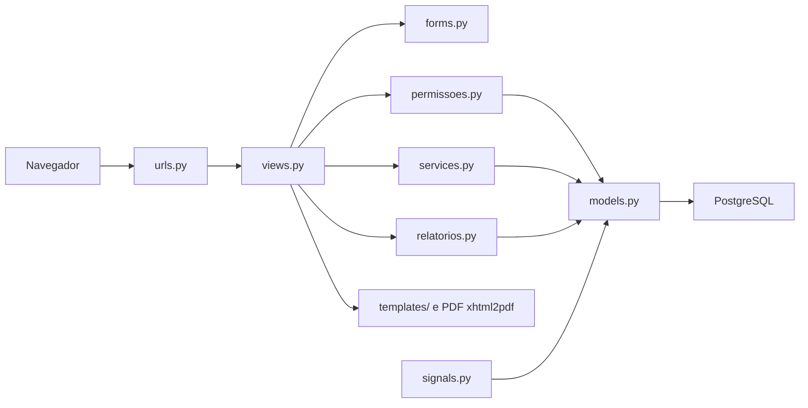

# Arquitetura do Registro de Ponto

Um projeto Django (`registro_ponto`) com um único app (`ponto`), PostgreSQL como banco
e templates renderizados no servidor. As views leem o papel do usuário em `Perfil`
e delegam o que cada um pode ver a `permissoes.py` e os cálculos de horas a `relatorios.py`.

## Fluxo de dependências

## Módulos

| Caminho | Responsabilidade |
| --- | --- |
| `registro_ponto/settings.py` | Configuração; lê segredos e banco do `.env` com python-decouple |
| `ponto/models.py` | `Funcao`, `Perfil`, `RegistroPonto`, `HistoricoAlteracaoPonto`, `SolicitacaoAjustePonto` |
| `ponto/views.py` | Telas e ações: painel, batida, equipe, ajustes, histórico, relatórios, PDF e cadastro |
| `ponto/permissoes.py` | `funcionarios_visiveis`: quais usuários cada papel enxerga |
| `ponto/services.py` | Sequência e gravação de batidas; dados prontos para as telas e o PDF |
| `ponto/relatorios.py` | Horas do dia, saldo, resumo do período e progresso do relógio |
| `ponto/constants.py` | Regras de jornada, limites das telas e textos fixos, num só lugar |
| `ponto/signals.py` | Cria o `Perfil` de todo usuário novo |
| `ponto/forms.py` | Formulários de cadastro, lançamento, solicitações e relatório |
| `ponto/templatetags/` | Filtro que exibe durações como `7h45min` |
| `ponto/templates/` | `base.html`, `base_interna.html`, telas e a folha de ponto em PDF |
| `ponto/static/ponto/` | `estilo.css` (header e login), `interno.css` e `interno.js` (telas internas), Figtree e a logo |

## Modelos

| Modelo | Papel no domínio |
| --- | --- |
| `Perfil` | Um por usuário (`OneToOneField`, `related_name="perfil"`): papel, gestor, função e CPF |
| `Funcao` | Cargo do colaborador, impresso no PDF |
| `RegistroPonto` | Uma batida: colaborador, tipo, data e hora, se foi manual e o campo `ativo` do soft delete |
| `HistoricoAlteracaoPonto` | Auditoria de inclusões e exclusões, com autor e motivo |
| `SolicitacaoAjustePonto` | Pedido de inclusão ou exclusão com status Pendente, Aprovado ou Rejeitado |

As chaves primárias são `BigAutoField` (`DEFAULT_AUTO_FIELD` em `settings.py`).

## Perfis e permissões

Toda view autenticada lê `request.user.perfil`; um usuário sem perfil quebraria as
telas com `RelatedObjectDoesNotExist`. Por isso o signal `post_save` de `User` cria o
perfil na criação do usuário, e a migração `0006` cria o perfil de quem já existia
sem ele ([decisão](DECISOES.md#perfil-criado-por-signal--18112026)).

`funcionarios_visiveis` define o alcance de cada papel:

| Papel | Usuários visíveis |
| --- | --- |
| **Administrador** | Todos os usuários com perfil |
| **Gestor** | Os usuários cujo perfil aponta para ele como gestor |
| **Colaborador** | Nenhum outro usuário |

## Regras de cálculo

| Regra | Valor | Onde |
| --- | --- | --- |
| Ordem das batidas | Entrada, saída almoço, volta almoço, saída café, volta café, saída | `RegistroPonto.ORDEM_TIPOS` |
| Intervalo mínimo entre batidas | 10 minutos | `INTERVALO_MINIMO_MINUTOS` em `constants.py` |
| Jornada diária | `7h45min` | `JORNADA_DIARIA` em `constants.py` |
| Tolerância do saldo | 10 minutos, para mais ou para menos | `TOLERANCIA_SALDO` em `constants.py` |
| Desconto de intervalo | Só o almoço, quando as duas batidas existem | `calcular_horas_dia` |

Um dia só entra no saldo quando tem entrada e saída. As horas normais de cada dia
ficam limitadas à jornada; o excedente conta como hora extra.

## Interface interna

As telas internas estendem `base_interna.html`, que carrega `interno.css` e `interno.js`.
Todas as regras de `interno.css` ficam sob `.principal-interno`, então o header e as telas de
login, cadastro e redefinição de senha, que usam só `estilo.css`, não mudam. A Figtree é servida
de `static/ponto/fonts/`, sem dependência externa. Os parciais `_campo.html`, `_voltar.html`,
`_linha_do_dia.html` e `_erros_formulario.html` mantêm campos, botão de voltar e linha do dia iguais
em todas as telas. O botão **Voltar ao topo**, no canto inferior direito, aparece depois de rolar 200 px,
devolve o foco à logo do header e respeita a preferência por movimento reduzido. O desenho de referência está
em [design](../design/README.md).

## Arquivos estáticos e e-mail

O WhiteNoise serve os estáticos com `CompressedManifestStaticFilesStorage`, que exige
`collectstatic` quando `DEBUG=False`; o entrypoint do Docker já roda esse comando.
O e-mail usa o backend SMTP do Gmail na porta 587 com TLS, configurado pelas
variáveis `EMAIL_*` ([Implantação](IMPLANTACAO.md#variáveis-de-ambiente)).
