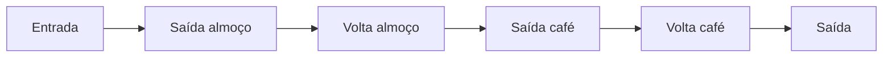

# Uso do Registro de Ponto

O colaborador registra cada batida do dia com um clique em **Registrar Ponto**; gestores
e administradores acompanham a equipe, lançam pontos, revisam solicitações e geram relatórios.
As regras de cálculo citadas aqui estão detalhadas em [Arquitetura](ARQUITETURA.md#regras-de-cálculo).

## Papéis

| Papel | O que pode fazer |
| --- | --- |
| **Colaborador** | Bater ponto, consultar as próprias batidas, solicitar ajustes e gerar o próprio relatório |
| **Gestor** | Tudo do colaborador, mais ver a própria equipe, lançar e excluir pontos, aprovar ou rejeitar solicitações, consultar o histórico e gerar relatórios da equipe |
| **Administrador** | Tudo do gestor, para todos os colaboradores cadastrados |

Todo usuário recebe um perfil ao ser criado, pela tela de cadastro, pelo
`createsuperuser` ou pelo admin: o superusuário vira **Administrador** e os demais,
**Colaborador**. Para promover alguém a **Gestor**, definir o gestor de cada
colaborador e cadastrar as **Funções**, use a seção **Perfis** em `/admin/`.

## Bater ponto

**Implementado.** O sistema identifica a próxima batida do dia na ordem abaixo:

- O botão diz qual batida será gravada, como **Registrar saída para o café**.
- Entre duas batidas é preciso esperar 10 minutos; antes disso a tela mostra
  "Você só pode bater ponto a cada 10 minutos.".
- Depois da sexta batida, a tela mostra "Todos os pontos do dia foram batidos.".

## Painel

**Implementado.** A página inicial tem o relógio de jornada à direita e, ao lado, as abas
**Hoje**, **Ontem** e, para gestores e administradores, **Sua equipe**. Cada aba tem endereço
próprio (`/?aba=ontem`, `/?aba=equipe`) e as setas do teclado trocam de aba.

- **Linha do dia**, na aba **Hoje**: as 6 batidas em ordem, com os horários feitos e a próxima destacada.
- **Relógio de jornada**: um anel que se preenche com o tempo trabalhado no dia,
  descontando o almoço; azul em andamento e verde com a jornada completa. Passada a
  jornada de `7h45min` mais a tolerância de 10 minutos, um trecho âmbar mostra a hora
  extra. Abaixo, o que falta (ou a hora extra) e a jornada do dia.
- **Batidas de hoje**, com **Pedir exclusão** em cada uma, ou o selo **Exclusão pendente**.
- **Ontem**: a linha do dia anterior, o total trabalhado, a situação e as batidas.
- **Sua equipe**: uma linha por pessoa, com a situação (**Em jornada**, **No almoço**,
  **No café**, **Jornada encerrada** ou **Sem entrada**), a última batida e as horas trabalhadas.

Para gestores e administradores, o painel também avisa no topo quantas solicitações
aguardam revisão.

O menu do topo se adapta ao papel: gestores e administradores veem também
**Equipe**, **Solicitações Pendentes** e **Histórico de Alterações**.

## Ajustes de ponto

**Implementado.** O colaborador pede ajustes, que ficam **Pendentes** até a revisão:

- **Inclusão**: para uma batida esquecida, com tipo, data e hora e motivo.
- **Exclusão**: para uma batida registrada por engano, a partir do painel e com
  motivo. Cada colaborador só pede a exclusão das próprias batidas.

Gestores e administradores revisam as solicitações da equipe em **Solicitações Pendentes**:

1. **Aprovar** inclui ou exclui a batida e registra a alteração no histórico.
2. **Rejeitar** pede o motivo da rejeição.

**Equipe** mostra uma linha por pessoa, com a situação, as 6 batidas do dia e as horas
trabalhadas; clicar num horário abre a exclusão daquela batida. Gestores também lançam
batidas manualmente, sempre com motivo; ao escolher a pessoa e a data, o lançamento mostra
as batidas que ela já tem no dia.
A exclusão marca o registro como inativo (soft delete) e não o remove do banco.
**Histórico de Alterações** lista inclusões e exclusões da equipe, com a batida alterada,
quem fez, quando e por quê, e filtra por colaborador, ação e período.

## Relatório de banco de horas

**Implementado.** Escolha o período e o colaborador, ou marque **Gerar para toda a equipe**.
**Gerar relatório** exibe o cartão ponto em PDF dentro da página, num visualizador que rola
por todas as páginas; **Abrir em nova aba** mostra o mesmo PDF em tela cheia. **Baixar PDF**
baixa o arquivo direto. O administrador acessa todos os colaboradores; o gestor, apenas
seus subordinados; o colaborador, apenas o próprio relatório. A mesma restrição vale para
visualizar e baixar o PDF, inclusive ao alterar os parâmetros da URL ou marcar toda a equipe.

O **Cartão Ponto** tem uma página por pessoa quando a equipe inteira é gerada. O cartão traz:

- cabeçalho com a logo, o período e a data de emissão; rodapé com **Página X de Y**;
- dados da empresa e do colaborador (nome, CPF, função e gestor) e o horário de trabalho
  de segunda a sexta;
- uma linha por dia com as 6 batidas (`ENT. 1` a `SAÍ. 3`), **NORMAIS**, **FALTAS**,
  **EXTRAS**, **CARGA** e **OBS.**, e a linha de **TOTAIS**;
- legenda, declaração de conferência e assinaturas do colaborador e do gestor.

**NORMAIS** e **EXTRAS** seguem a regra de cálculo do sistema (`calcular_resumo`).
**FALTAS** soma o saldo devedor dos dias completos e a jornada inteira dos dias úteis já
passados sem nenhuma batida (**Falta**); dias futuros ficam em branco. Dias com batidas, mas sem entrada ou saída, saem como
**Incompleto**, sem horas calculadas. Batidas lançadas manualmente recebem `*`. Os dados da
empresa e o horário impresso ficam em `ponto/constants.py`.

## Conta e acesso

**Implementado.**

- **Cadastro**: a pessoa se cadastra pela tela de login com nome, usuário, e-mail,
  CPF, **Função** e senha, e entra como **Colaborador**. O cadastro exige senhas
  iguais, usuário e CPF únicos e CPF com 11 dígitos, com ou sem pontos e traço.
- **Esqueceu sua senha?** envia por e-mail um link para criar uma nova senha. O envio
  depende das credenciais SMTP descritas em [Implantação](IMPLANTACAO.md#variáveis-de-ambiente).
- **Funções** são cadastradas no admin, vinculadas ao perfil e impressas no PDF.

## Rotas

| Rota | Descrição | Acesso |
| --- | --- | --- |
| `/login/` | Login | Público |
| `/ponto/cadastro_usuario/` | Cadastro de novo usuário | Público |
| `/password_reset/` | Redefinição de senha por e-mail | Público |
| `/` | Painel do usuário | Todos |
| `/bater_ponto/` | Registra a próxima batida | Todos |
| `/ponto/solicitar/criacao/` | Solicitar inclusão de batida | Todos |
| `/ponto/solicitar/exclusao/<id>/` | Solicitar exclusão de batida | Dono da batida |
| `/ponto/solicitacoes_pendentes/` | Solicitações pendentes da equipe | Gestor e Administrador |
| `/ponto/aprovar/<id>/` | Aprovar solicitação | Gestor e Administrador |
| `/ponto/rejeitar/<id>/` | Rejeitar solicitação com motivo | Gestor e Administrador |
| `/ponto/historico/` | Histórico de alterações da equipe | Gestor e Administrador |
| `/ponto/relatorios/` | Relatório de banco de horas | Todos; o colaborador vê só os próprios dados |
| `/ponto/relatorio/pdf/` | Exportação do relatório em PDF | Todos; o colaborador vê só os próprios dados |
| `/equipe/` | Batidas do dia da equipe | Gestor e Administrador |
| `/ponto/criar/` | Lançamento manual de ponto | Gestor e Administrador |
| `/ponto/excluir/<id>/` | Exclusão de ponto com motivo | Gestor e Administrador |
| `/admin/` | Painel administrativo do Django | Superusuário |

## Registro por reconhecimento facial

**Implementado:** o painel oferece **Registrar por câmera** para confirmar o rosto da
pessoa logada. **Cadastros faciais** fica em **Gestão**; **Abrir terminal compartilhado**,
em **Administração**. Ambos estão disponíveis a gestores e administradores.
O registro comum continua disponível sem câmera.

1. O gestor abre **Gestão → Cadastros faciais**, seleciona a pessoa, confere sua identidade
   presencialmente e confirma **Cadastrar rosto**; a câmera abre automaticamente. Pode substituir ou remover
   o cadastro nessa mesma tela. Gestores só cadastram sua equipe e o próprio rosto;
   administradores podem cadastrar qualquer pessoa ativa.
2. No registro pessoal, o colaborador entra com sua conta, abre **Registrar por câmera**,
   autoriza a câmera no navegador quando solicitado e posiciona o rosto. O ponto é gravado
   automaticamente e a câmera é desligada após a confirmação.
3. Para um PC compartilhado, o gestor usa **Abrir terminal compartilhado**. Isso encerra
   a sessão dele e libera somente o registro facial de sua equipe e dele próprio, por até
   12 horas. A câmera abre e reconhece cada pessoa automaticamente. **Encerrar terminal**
   encerra essa autorização; um gestor precisa entrar novamente para reabrir.

O rosto reconhecido grava a próxima batida com o horário do servidor. Valem a mesma
sequência e o intervalo mínimo de 10 minutos do botão comum. Rosto desconhecido, mais de
um rosto ou identificação ambígua não gravam ponto. O terminal não autentica a pessoa
reconhecida nem dá acesso às telas de gestão.

No terminal, a câmera continua aguardando pessoas. Permanecer no enquadramento não gera
novas batidas, mesmo depois de 10 minutos: a pessoa deve sair do enquadramento ou dar lugar
a outra pessoa reconhecida. O intervalo mínimo também vale quando ela retorna.
As tentativas são sequenciais, normalmente com 3,5 segundos de intervalo. Após uma batida
nova, a confirmação fica visível por 3 segundos e o terminal retoma a identificação. Não há
clique para identificar ou registrar. **Pausar câmera** interrompe as capturas;
**Retomar câmera** permite reabrir após pausa ou falha. Sair da aba também pausa a câmera.

Após gravar, a tela mostra **PONTO REGISTRADO - CAIO**, usando apenas o primeiro nome,
sem tipo de batida nem horário. A foto escolhida no perfil é exibida por 3 segundos;
sem foto, aparece uma imagem genérica com o nome completo. Permanecer na câmera não
repete a confirmação nem grava outra batida. Erros e bloqueios não mostram confirmação de sucesso.

É preciso uma câmera conectada, permissão no navegador e HTTPS em produção
(`localhost` funciona no desenvolvimento; HTTP pelo IP da rede não libera a câmera).
Veja a [documentação do navegador](https://developer.mozilla.org/en-US/docs/Web/API/MediaDevices/getUserMedia).
Sem câmera, com permissão negada ou câmera ocupada, a tela orienta o uso do registro comum.

**Limitação conhecida:** não há prova de vida; uma foto ou vídeo pode enganar a comparação.
A precisão precisa ser validada com as pessoas, iluminação e câmeras do local. A imagem
capturada fica apenas em memória durante o processamento; o banco guarda o vetor biométrico
SFace, a pessoa responsável pelo cadastro e a data de atualização. Remover o cadastro
apaga esse vetor do banco ativo; backups seguem a rotina de retenção da implantação.

| Rota | Acesso |
| --- | --- |
| `/ponto/camera/` | Pessoa logada; verifica apenas seu próprio rosto |
| `/ponto/camera/cadastro/` | Gestor ou administrador; cadastro e remoção supervisionados |
| `/ponto/camera/abrir-terminal/` | POST do gestor; encerra login e cria sessão restrita |
| `/terminal/` | Sessão de terminal autorizada; identifica somente pessoas ativas no seu alcance |

## Menu e administração

**Implementado:** o cabeçalho usa submenus por clique. **Início** abre o painel;
**Meu ponto** reúne registro por câmera, solicitação de ajuste, relatório e, por último, **Meu perfil**.
**Gestão**, disponível para gestores e administradores, reúne equipe, lançamento manual,
solicitações pendentes, histórico e cadastro facial. **Administração** reúne **Usuários**,
**Envio de e-mails** e **Abrir terminal compartilhado** para administradores; para gestores,
mostra apenas a abertura do terminal. **Cadastrar usuário** fica na página **Usuários**.

O clique em outro grupo fecha o anterior; clique fora ou `Escape` fecha o submenu.
Também é possível abrir pelo teclado usando `Tab` e `Enter`. Cabeçalho e conteúdo
ocupam a largura disponível, com margens de 24 px em 1333 px e de 12 px no celular.

### Cadastrar e configurar usuários

Em **Administração → Usuários**, use **Cadastrar usuário**. Preencha nome, sobrenome,
nome de usuário, e-mail, senha e confirmação; CPF, função e gestor podem ser definidos
na mesma tela. Escolha o papel **Colaborador**, **Gestor** ou **Administrador**.
A seleção de gestor inclui somente gestores ativos.
O CPF usa a máscara **000.000.000-00** no cadastro e na edição; o banco guarda apenas os números.

A lista permite buscar por nome, usuário ou e-mail e abrir **Editar**. Na edição,
senha em branco conserva a senha atual. Desmarcar **Usuário ativo** bloqueia o acesso
sem excluir os pontos. Sua própria conta não pode ser desativada nem perder o papel de
Administrador por essa tela. O papel de Administrador dá acesso à administração do
Registro de Ponto; não transforma a conta em superusuário do Django.

O cadastro público na tela de login continua disponível e cria apenas colaboradores;
os vínculos e permissões podem ser ajustados pelo administrador na nova tela.

### Configurar o envio de e-mails

Em **Administração → Envio de e-mails**, informe servidor SMTP, porta, segurança
(STARTTLS, SSL/TLS ou sem criptografia), usuário de autenticação, remetente e senha.
Use os dados fornecidos pelo provedor; alguns exigem senha de aplicativo.

**Salvar configuração** passa a aplicar esses dados aos envios do sistema, inclusive
recuperação de senha. A senha atual não aparece na tela; deixá-la em branco mantém
seu valor, e a opção **Remover a senha de autenticação atual** permite apagá-la.
Até o primeiro salvamento, permanece em uso a configuração do ambiente.

Para conferir a conexão, salve primeiro e informe um endereço em **Enviar teste para**.
**Enviar teste** dispara uma mensagem para esse endereço. A confirmação significa que
o servidor aceitou o envio; confira também caixa de entrada e spam. Falhas de teste
não mostram sucesso. Alterar o e-mail de uma pessoa em Usuários não muda o remetente SMTP.

| Rota | Acesso |
| --- | --- |
| `/administracao/usuarios/` | Administrador; lista e busca de contas |
| `/administracao/usuarios/novo/` | Administrador; cadastro |
| `/administracao/usuarios/<id>/` | Administrador; edição |
| `/administracao/email/` | Administrador; configuração SMTP e teste de envio |

### A câmera não pôde ser aberta

**Limitação conhecida:** `NotReadableError` significa que o navegador não conseguiu
acessar o dispositivo, mesmo com permissão. Pode envolver outra aba ou aplicativo,
bloqueio de privacidade, driver ou falha do dispositivo. Veja a
[referência do navegador](https://developer.mozilla.org/en-US/docs/Web/API/MediaDevices/getUserMedia#exceptions).
Feche outros usos da câmera, confira a tampa física e a permissão no sistema, e use
**Retomar câmera**. Se continuar, teste a webcam no aplicativo do sistema. Essa falha
acontece antes de enviar a imagem ao reconhecimento; `_lock` no servidor não reserva a webcam.

### Saber quem já possui cadastro facial

Em **Gestão → Cadastros faciais**, a lista identifica as pessoas como **Cadastrado** ou
**Sem cadastro**. Ao selecionar alguém, a tela consulta novamente o banco e mostra:

- **Rosto não cadastrado:** oferece **Cadastrar rosto** e mantém a remoção oculta.
- **Rosto cadastrado:** faixa verde ocupa a largura do cartão; oferece **Substituir rosto** e **Remover cadastro facial**.

Substituir e remover abrem um diálogo da aplicação com a pessoa selecionada, sem o sufixo
de estado. **Cancelar** ou `Escape` fecha sem alterar o cadastro; a operação só é enviada
após a confirmação.

O estado e o rótulo da pessoa na lista são atualizados após cadastrar, substituir ou
remover, sem recarregar a página. Durante o envio, a seleção fica bloqueada para manter
a ação vinculada à pessoa escolhida. Enquanto a consulta está em andamento ou falha,
a tela não permite cadastrar, substituir ou remover com base em um estado desconhecido.
A câmera continua abrindo automaticamente; remover um cadastro não exige câmera ligada.

Ao concluir a captura, **Rosto cadastrado para [nome]** aparece em um cartão verde sobre a
prévia durante 3 segundos. Depois, a seleção e a retomada da câmera ficam disponíveis.
Na tela de registro pessoal, quem ainda não tem cadastro vê um aviso destacado no topo;
ele permanece visível mesmo se a câmera não abrir.

## Foto de perfil e confirmação do ponto

Abra **Meu ponto → Meu perfil**, escolha um arquivo JPEG, PNG ou WebP de até 5 MB e
use **Salvar foto**. Fotos grandes, inclusive acima de 16 milhões de pixels, são reduzidas
automaticamente. A foto é enquadrada em 512 × 512 pixels e salva em WebP. **Remover foto de perfil**
volta à imagem genérica com seu nome. Cada colaborador escolhe sua própria foto.

Essa foto é usada na confirmação da batida; o cadastro facial para identificação
continua sob responsabilidade do gestor. São dados independentes. As imagens capturadas
pela câmera para reconhecimento continuam sendo descartadas após o processamento.

As fotos são privadas. Usuários veem a própria foto; gestores e administradores podem
ver as fotos das pessoas sob seu acesso. No terminal compartilhado, somente a foto da
última pessoa cujo ponto foi confirmado fica acessível, dentro do alcance do gestor.
A confirmação é encerrada ao sair da aba ou pausar a câmera.
