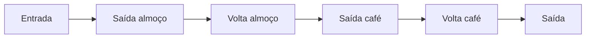

# Uso do Registro de Ponto

O funcionário registra cada batida do dia com um clique em **Registrar Ponto**; gestores
e administradores acompanham a equipe, lançam pontos, revisam solicitações e geram relatórios.
As regras de cálculo citadas aqui estão detalhadas em [Arquitetura](ARQUITETURA.md#regras-de-cálculo).

## Papéis

| Papel | O que pode fazer |
| --- | --- |
| **Funcionário** | Bater ponto, consultar as próprias batidas, solicitar ajustes e gerar o próprio relatório |
| **Gestor** | Tudo do funcionário, mais ver a própria equipe, lançar e excluir pontos, aprovar ou rejeitar solicitações, consultar o histórico e gerar relatórios da equipe |
| **Administrador** | Tudo do gestor, para todos os funcionários cadastrados |

Todo usuário recebe um perfil ao ser criado, pela tela de cadastro, pelo
`createsuperuser` ou pelo admin: o superusuário vira **Administrador** e os demais,
**Funcionário**. Para promover alguém a **Gestor**, definir o gestor de cada
funcionário e cadastrar as **Funções**, use a seção **Perfis** em `/admin/`.

## Bater ponto

**Implementado.** O sistema identifica a próxima batida do dia na ordem abaixo:

- O botão diz qual batida será gravada, como **Registrar saída para o café**.
- Entre duas batidas é preciso esperar 10 minutos; antes disso a tela mostra
  "Você só pode bater ponto a cada 10 minutos.".
- Depois da sexta batida, a tela mostra "Todos os pontos do dia foram batidos.".

## Painel

**Implementado.** A página inicial tem o relógio de jornada à direita e, ao lado, as abas
**Hoje**, **Ontem** e, para gestores e administradores, **Sua equipe**. Cada aba tem endereço
próprio (`/?aba=ontem`, `/?aba=equipe`) e as setas do teclado trocam de aba.

- **Linha do dia**, na aba **Hoje**: as 6 batidas em ordem, com os horários feitos e a próxima destacada.
- **Relógio de jornada**: um anel que se preenche com o tempo trabalhado no dia,
  descontando o almoço; azul em andamento e verde com a jornada completa. Passada a
  jornada de `7h45min` mais a tolerância de 10 minutos, um trecho âmbar mostra a hora
  extra. Abaixo, o que falta (ou a hora extra) e a jornada do dia.
- **Batidas de hoje**, com **Pedir exclusão** em cada uma, ou o selo **Exclusão pendente**.
- **Ontem**: a linha do dia anterior, o total trabalhado, a situação e as batidas.
- **Sua equipe**: uma linha por pessoa, com a situação (**Em jornada**, **No almoço**,
  **No café**, **Jornada encerrada** ou **Sem entrada**), a última batida e as horas trabalhadas.

Para gestores e administradores, o painel também avisa no topo quantas solicitações
aguardam revisão.

O menu do topo se adapta ao papel: gestores e administradores veem também
**Equipe**, **Solicitações Pendentes** e **Histórico de Alterações**.

## Ajustes de ponto

**Implementado.** O funcionário pede ajustes, que ficam **Pendentes** até a revisão:

- **Inclusão**: para uma batida esquecida, com tipo, data e hora e motivo.
- **Exclusão**: para uma batida registrada por engano, a partir do painel e com
  motivo. Cada funcionário só pede a exclusão das próprias batidas.

Gestores e administradores revisam as solicitações da equipe em **Solicitações Pendentes**:

1. **Aprovar** inclui ou exclui a batida e registra a alteração no histórico.
2. **Rejeitar** pede o motivo da rejeição.

**Equipe** mostra uma linha por pessoa, com a situação, as 6 batidas do dia e as horas
trabalhadas; clicar num horário abre a exclusão daquela batida. Gestores também lançam
batidas manualmente, sempre com motivo; ao escolher a pessoa e a data, o lançamento mostra
as batidas que ela já tem no dia.
A exclusão marca o registro como inativo (soft delete) e não o remove do banco.
**Histórico de Alterações** lista inclusões e exclusões da equipe, com a batida alterada,
quem fez, quando e por quê, e filtra por funcionário, ação e período.

## Relatório de banco de horas

**Implementado.** Escolha o período e o funcionário, ou marque **Gerar para toda a equipe**.
**Gerar relatório** exibe o cartão ponto em PDF dentro da página, num visualizador que rola
por todas as páginas; **Abrir em nova aba** mostra o mesmo PDF em tela cheia. **Baixar PDF**
baixa o arquivo direto. O funcionário gera só o próprio relatório.

O **Cartão Ponto** tem uma página por pessoa quando a equipe inteira é gerada. O cartão traz:

- cabeçalho com a logo, o período e a data de emissão; rodapé com **Página X de Y**;
- dados da empresa e do funcionário (nome, CPF, função e gestor) e o horário de trabalho
  de segunda a sexta;
- uma linha por dia com as 6 batidas (`ENT. 1` a `SAÍ. 3`), **NORMAIS**, **FALTAS**,
  **EXTRAS**, **CARGA** e **OBS.**, e a linha de **TOTAIS**;
- legenda, declaração de conferência e assinaturas do funcionário e do gestor.

**NORMAIS** e **EXTRAS** seguem a regra de cálculo do sistema (`calcular_resumo`).
**FALTAS** soma o saldo devedor dos dias completos e a jornada inteira dos dias úteis já
passados sem nenhuma batida (**Falta**); dias futuros ficam em branco. Dias com batidas, mas sem entrada ou saída, saem como
**Incompleto**, sem horas calculadas. Batidas lançadas manualmente recebem `*`. Os dados da
empresa e o horário impresso ficam em `ponto/constants.py`.

## Conta e acesso

**Implementado.**

- **Cadastro**: a pessoa se cadastra pela tela de login com nome, usuário, e-mail,
  CPF, **Função** e senha, e entra como **Funcionário**. O cadastro exige senhas
  iguais, usuário e CPF únicos e CPF com 11 dígitos, com ou sem pontos e traço.
- **Esqueceu sua senha?** envia por e-mail um link para criar uma nova senha. O envio
  depende das credenciais SMTP descritas em [Implantação](IMPLANTACAO.md#variáveis-de-ambiente).
- **Funções** são cadastradas no admin, vinculadas ao perfil e impressas no PDF.

## Rotas

| Rota | Descrição | Acesso |
| --- | --- | --- |
| `/login/` | Login | Público |
| `/ponto/cadastro_usuario/` | Cadastro de novo usuário | Público |
| `/password_reset/` | Redefinição de senha por e-mail | Público |
| `/` | Painel do usuário | Todos |
| `/bater_ponto/` | Registra a próxima batida | Todos |
| `/ponto/solicitar/criacao/` | Solicitar inclusão de batida | Todos |
| `/ponto/solicitar/exclusao/<id>/` | Solicitar exclusão de batida | Dono da batida |
| `/ponto/solicitacoes_pendentes/` | Solicitações pendentes da equipe | Gestor e Administrador |
| `/ponto/aprovar/<id>/` | Aprovar solicitação | Gestor e Administrador |
| `/ponto/rejeitar/<id>/` | Rejeitar solicitação com motivo | Gestor e Administrador |
| `/ponto/historico/` | Histórico de alterações da equipe | Gestor e Administrador |
| `/ponto/relatorios/` | Relatório de banco de horas | Todos; o funcionário vê só os próprios dados |
| `/ponto/relatorio/pdf/` | Exportação do relatório em PDF | Todos; o funcionário vê só os próprios dados |
| `/equipe/` | Batidas do dia da equipe | Gestor e Administrador |
| `/ponto/criar/` | Lançamento manual de ponto | Gestor e Administrador |
| `/ponto/excluir/<id>/` | Exclusão de ponto com motivo | Gestor e Administrador |
| `/admin/` | Painel administrativo do Django | Superusuário |
