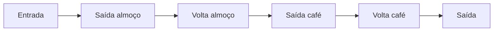

# Uso do Registro de Ponto

O funcionário registra cada batida do dia com um clique em **Registrar Ponto**; gestores
e administradores acompanham a equipe, lançam pontos, revisam solicitações e geram relatórios.
As regras de cálculo citadas aqui estão detalhadas em [Arquitetura](ARQUITETURA.md#regras-de-cálculo).

## Papéis

| Papel | O que pode fazer |
| --- | --- |
| **Funcionário** | Bater ponto, consultar as próprias batidas, solicitar ajustes e gerar o próprio relatório |
| **Gestor** | Tudo do funcionário, mais ver a própria equipe, lançar e excluir pontos, aprovar ou rejeitar solicitações, consultar o histórico e gerar relatórios da equipe |
| **Administrador** | Tudo do gestor, para todos os funcionários cadastrados |

Todo usuário recebe um perfil ao ser criado, pela tela de cadastro, pelo
`createsuperuser` ou pelo admin: o superusuário vira **Administrador** e os demais,
**Funcionário**. Para promover alguém a **Gestor**, definir o gestor de cada
funcionário e cadastrar as **Funções**, use a seção **Perfis** em `/admin/`.

## Bater ponto

**Implementado.** O sistema identifica a próxima batida do dia na ordem abaixo:

- Entre duas batidas é preciso esperar 10 minutos; antes disso a tela mostra
  "Você só pode bater ponto a cada 10 minutos.".
- Depois da sexta batida, a tela mostra "Todos os pontos do dia foram batidos.".

## Painel

**Implementado.** A página inicial mostra:

- **Relógio de jornada**: um anel que se preenche com o tempo trabalhado no dia,
  descontando o almoço. A cor indica aguardando entrada, em andamento, jornada
  completa ou hora extra. Passada a jornada de `7h45min` mais a tolerância de
  10 minutos, um segundo anel mostra a hora extra. Ao passar o mouse, aparecem o
  tempo trabalhado, o que falta e a hora extra.
- **Batidas de hoje**, com a opção de solicitar a exclusão de cada uma.
- **Batidas de ontem**, numa seção que abre e fecha.

O menu do topo se adapta ao papel: gestores e administradores veem também
**Equipe**, **Solicitações Pendentes** e **Histórico de Alterações**.

## Ajustes de ponto

**Implementado.** O funcionário pede ajustes, que ficam **Pendentes** até a revisão:

- **Inclusão**: para uma batida esquecida, com tipo, data e hora e motivo.
- **Exclusão**: para uma batida registrada por engano, a partir do painel e com
  motivo. Cada funcionário só pede a exclusão das próprias batidas.

Gestores e administradores revisam as solicitações da equipe em **Solicitações Pendentes**:

1. **Aprovar** inclui ou exclui a batida e registra a alteração no histórico.
2. **Rejeitar** pede o motivo da rejeição.

Gestores também lançam batidas manualmente e excluem batidas, sempre com motivo.
A exclusão marca o registro como inativo (soft delete) e não o remove do banco.
**Histórico de Alterações** lista inclusões e exclusões da equipe, com quem fez,
quando e por quê.

## Relatório de banco de horas

**Implementado.** Escolha o período e o funcionário, ou marque **Gerar todos** para a
equipe inteira. Para cada dia, o relatório mostra:

| Coluna | Conteúdo |
| --- | --- |
| **Status** | *Completo* (com entrada e saída) ou *Incompleto*, com atalho para solicitar o ajuste |
| **Horas trabalhadas** | Da entrada à saída, descontando o almoço |
| **Jornada esperada** | `7h45min` por dia |
| **Saldo** | Trabalhado menos esperado: positivo é hora extra, negativo é hora devida |

Diferenças de até 10 minutos, para mais ou para menos, não entram no saldo do dia.
Os totais do período separam horas normais, limitadas à jornada de cada dia, e
horas extras. O funcionário gera só o próprio relatório.

**Baixar PDF** gera a **Folha de Ponto Individual de Trabalho** com o mesmo período e
funcionário: nome, função, todas as batidas de cada dia e um resumo com horas normais
e extras. Com **Gerar todos**, o arquivo traz uma folha por funcionário.

## Conta e acesso

**Implementado.**

- **Cadastro**: a pessoa se cadastra pela tela de login com nome, usuário, e-mail,
  CPF, **Função** e senha, e entra como **Funcionário**. O cadastro exige senhas
  iguais, usuário e CPF únicos e CPF com 11 dígitos, com ou sem pontos e traço.
- **Esqueceu sua senha?** envia por e-mail um link para criar uma nova senha. O envio
  depende das credenciais SMTP descritas em [Implantação](IMPLANTACAO.md#variáveis-de-ambiente).
- **Funções** são cadastradas no admin, vinculadas ao perfil e impressas no PDF.

## Rotas

| Rota | Descrição | Acesso |
| --- | --- | --- |
| `/login/` | Login | Público |
| `/ponto/cadastro_usuario/` | Cadastro de novo usuário | Público |
| `/password_reset/` | Redefinição de senha por e-mail | Público |
| `/` | Painel do usuário | Todos |
| `/bater_ponto/` | Registra a próxima batida | Todos |
| `/ponto/solicitar/criacao/` | Solicitar inclusão de batida | Todos |
| `/ponto/solicitar/exclusao/<id>/` | Solicitar exclusão de batida | Dono da batida |
| `/ponto/solicitacoes_pendentes/` | Solicitações pendentes da equipe | Gestor e Administrador |
| `/ponto/aprovar/<id>/` | Aprovar solicitação | Gestor e Administrador |
| `/ponto/rejeitar/<id>/` | Rejeitar solicitação com motivo | Gestor e Administrador |
| `/ponto/historico/` | Histórico de alterações da equipe | Gestor e Administrador |
| `/ponto/relatorios/` | Relatório de banco de horas | Todos; o funcionário vê só os próprios dados |
| `/ponto/relatorio/pdf/` | Exportação do relatório em PDF | Todos; o funcionário vê só os próprios dados |
| `/equipe/` | Batidas do dia da equipe | Gestor e Administrador |
| `/ponto/criar/` | Lançamento manual de ponto | Gestor e Administrador |
| `/ponto/excluir/<id>/` | Exclusão de ponto com motivo | Gestor e Administrador |
| `/admin/` | Painel administrativo do Django | Superusuário |
